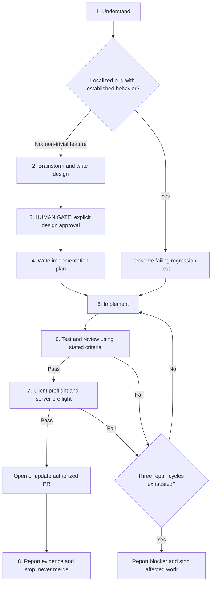

# AGENTS.md

Standing instructions for AI coding agents working in this repository. Read
this file before making changes; load supporting documentation only as needed
for the current task.

## What this project is

Jeevan Verse is a community health platform for individuals and health
organizations. It includes Umeed, an AI health assistant; Blood Bridge, a
blood request and volunteer network; health discussions; and organization
profiles and posts. The current product scope and known open questions are in
`docs/prd.md`. The implementation walkthrough is in `walkthrough.md`.

This product handles health-related information. Do not present AI or
community content as diagnosis or professional medical advice. Do not make
claims of medical verification, donor eligibility, or guaranteed matching
unless the feature and its operating process support that claim.

## Tech stack — do not deviate without asking

- Client: React, TypeScript, Vite, React Router, Redux Toolkit, Axios, and
  Tailwind CSS. Keep existing app conventions and dependencies.
- Server: Node.js, Express, and MongoDB through Mongoose.
- Authentication: JWT-based user and organization flows using HTTP-only
  cookies and the existing authentication middleware.
- Real-time events: Socket.IO.
- AI and document processing: Gemini, Pinecone, and PDF parsing through the
  existing service layer.
- File storage and email: Cloudinary and Nodemailer through existing helpers.
- Use the existing API response/error helpers, async wrapper, validation
  patterns, and model/controller/route organization. Do not add a new
  framework, database, state-management library, or service provider without
  a clear requirement and user approval.

## Skills

Repository-specific skills live under `.agents/skills/`. Before starting a
task, use this table to identify skills for the current phase; more than one
skill may apply. Load their entrypoints only when that phase begins.

Load each matching skill entrypoint only if it is not already available in
the current context, then read only the rules needed for the change. Use `rg`
to locate relevant rules rather than reading every rule or a compiled skill
`AGENTS.md`. Reuse context unless the files have changed. Local entrypoints
are adapted to this repository; preserve those adaptations during upstream
skill updates.

- Match skills to concrete work, not a speculative possibility. This
  overrides the local `using-superpowers` skill's "1% chance" loading rule.
- Load `using-superpowers` once, then only the current process skill and
  relevant domain skills. Planning does not require preloading implementation,
  review, and finishing skills. Load those when reaching their steps.
- A skill reference is navigation, not an instruction to recursively load
  every linked skill or reference. Follow links only for the current task;
  retain applicable safety rules and prerequisites.
- Reuse entrypoints already present in context unless changed or no longer
  available. Do not read both repository and plugin copies of the same skill.
- Give subagents their task, ownership, acceptance criteria, and necessary
  references. Do not copy the full conversation or every loaded skill.

| When the task involves | Use |
| --- | --- |
| Building a new screen or materially reshaping the visual design | `frontend-design` |
| Writing, reviewing, or refactoring React code; client performance, rendering, or bundle size | `vercel-react-best-practices` |
| Designing reusable component APIs, compound components, or refactoring boolean-heavy components | `vercel-composition-patterns` |
| An explicit UI, accessibility, or web-interface guidelines audit | `web-design-guidelines` |
| Planning, test-driven development, debugging, code review, or verification workflows | Repository Superpowers skills described below |
| Implementing Express routes, middleware, authentication, or request validation | `nodejs-backend-patterns` |
| Designing MongoDB schemas, indexes, aggregations, or queries | `mongodb-schema-design`, `mongodb-query-optimizer`, or `mongodb-natural-language-querying` as applicable |
| Evaluating backend transactions, idempotency, concurrency, or service boundaries | `backend-engineering` |

### Superpowers

This checkout includes [Superpowers](https://github.com/obra/superpowers)
7.0.1 under `.agents/skills/`, with its [MIT license](.agents/SUPERPOWERS-LICENSE.txt).
Use the repository copies even when a personal plugin is installed. Agents
without skill discovery can read the same `SKILL.md` files directly.

Start with `.agents/skills/using-superpowers/SKILL.md`, then load the skills
that fit the task. Resolve upstream names such as
`superpowers:test-driven-development` to the corresponding local directory.

- For feature design and implementation planning, use `brainstorming` and
  `writing-plans` as applicable.
- For bug fixes, use `systematic-debugging` and `test-driven-development`.
  Follow the client and server regression steps in step 6 below.
- For reviews and authorized verification, use the applicable code-review
  skill and `verification-before-completion`.
- Use `executing-plans` for inline implementation when delegation is
  unavailable or outside the task's scope.

Apply the repository workflow below when an upstream skill suggests checks,
Git operations, or other steps that require separate authorization.

Skills do not override this file or the user's request. Apply React/Next.js
guidance to this Vite client only where the advice fits React and the existing
architecture; do not introduce Next.js patterns or dependencies into this
project.

For substantial API engineering work, use the relevant installed Postman
skill when available. Postman CLI is installed in this environment. Do not
assume a repo-local Postman skill exists unless it is present in the checkout.

## Product and data rules

1. **Health safety:** Umeed is informational support, not a clinician. Keep
   safety language clear and avoid diagnoses, certainty, or treatment claims.
   Preserve suitable escalation guidance for urgent symptoms.
2. **Sensitive information:** Treat health profiles, chat content,
   prescriptions, contact details, and blood requests as sensitive. Do not
   expose them in logs, error messages, analytics, or unrelated API responses.
   Never read, print, or commit `.env` values or credentials.
3. **Authorization:** Authentication is not authorization. Every new read or
   write must verify that the signed-in user or organization is allowed to
   access the specific record. Reuse `auth.middleware.js`, `org.middleware.js`,
   and established controller checks; do not trust client-supplied ownership
   IDs.
4. **Data integrity:** Keep Mongoose schemas, controller behavior, and client
   expectations aligned. Validate input on the server even when the client
   validates it. Preserve existing enums and ownership/status rules unless a
   product decision explicitly changes them.
5. **User contact and consent:** Blood Bridge contact details and the
   volunteer `canShareDetails` preference must be handled deliberately. Do
   not broaden contact disclosure or send unsolicited messages as a shortcut.
6. **AI and uploads:** Validate file type and size server-side, handle parser
   and provider errors, and avoid retaining or forwarding files beyond the
   existing product behavior. Do not claim a prescription interpretation is
   clinically verified.
7. **Feature claims:** Distinguish implemented behavior from planned or
   unverified claims. In particular, do not describe geolocation matching,
   expert verification, anonymous groups, or moderation coverage as live
   capabilities without confirming implementation and operations.

## Workflow

The eight steps below are the canonical workflow. Use the local Superpowers
skills within these steps; do not create a competing sequence.

### 1. Understand

- For feature, entity, screen, or user-flow changes, read the relevant
  sections of `docs/prd.md` and `walkthrough.md`. For instruction-only,
  formatting, or test-only work, read those documents only when product
  behavior or architecture is needed to resolve a question.
- Inspect the existing route, controller, model, service, and client page or
  component before introducing a parallel implementation.
- If requirements for health-data handling, privacy, authorization, or user
  contact are ambiguous, identify the uncertainty and avoid inventing a
  product policy.

### 2. Brainstorm

- For non-trivial features, use `brainstorming` to clarify uncertainties,
  compare approaches, and write a design with acceptance criteria.
- Small, fully specified documentation or cosmetic edits may skip steps 2
  and 3. A localized bug with established expected behavior may use the
  shortcut below. If product behavior or architecture needs a decision,
  return to brainstorming instead of inventing requirements.

### 3. Approve the design — human gate

- Present the design for the user's explicit approval before writing
  implementation code or dispatching implementation agents. Reading code
  and investigating behavior may continue before approval.
- Silence, elapsed time, or approval of an earlier proposal is not approval
  of the presented design. Reuse approval already given for that design;
  ask again only if a material scope or design change needs a new decision.

### 4. Write the implementation plan

- For work spanning multiple files or layers, give a short plan before
  editing: the affected areas and how the change will be checked.
- After design approval, use `writing-plans`. Record acceptance criteria,
  dependencies, file ownership, and verification commands. Delegate only
  independent tasks; assign one writer per file and agree on shared API
  contracts before frontend and backend work proceeds in parallel.
- Prefer the smallest change that fully satisfies the request. Avoid
  unrelated refactors and formatting churn.
- Keep existing client/server boundaries: UI in `client/`, API behavior in
  `server/`, and shared product documentation in `docs/`.

### 5. Implement

- Follow the existing flow: client API module/component → Express route →
  controller → service/model as appropriate. Keep business rules out of UI
  components and transport details out of Mongoose models.
- Put reusable external-service logic in `server/src/service/` or the
  existing utility modules rather than duplicating it in controllers.
- Keep route middleware and user/organization role boundaries explicit.
- Reuse existing UI components and styling patterns. Preserve responsive
  behavior, accessible labels, keyboard interaction, and loading, empty, and
  error states.
- Update `docs/prd.md` or `walkthrough.md` only when the requested change
  changes product behavior or makes their descriptions inaccurate.
- Do not add dependencies unless they are needed and fit the existing stack.

### 6. Test and review

For client and server bug fixes, write or update a regression test and
observe it fail for the reported behavior before changing production code.
A setup error or unavailable service does not establish reproduction. Run
the focused test after the fix, then the affected application's suite. If
automated reproduction is infeasible, report the limitation and agree on an
alternative with the user before implementing the fix.

Bug-fix regression checks and the PR gate in step 7 are standing
authorization to run those checks. For other tasks outside that gate, run
tests or verification commands when the user requests them. A
request to set up or fix tests or increase coverage authorizes the relevant
checks throughout that task. For instruction-only edits, review the changed
text and references without running application checks unless requested or
preparing a PR.

When checks are requested, choose the scripts appropriate to the change.
Run from `client/`; use `npm.cmd` on Windows if PowerShell blocks `npm.ps1`:

```powershell
# Formatting, lint, TypeScript, tests with coverage, and production build
npm.cmd run preflight

# Individual checks, when the full preflight is unnecessary
npm.cmd run lint
npm.cmd run typecheck
npm.cmd test

# TypeScript checks and production bundle
npm.cmd run build
```

Use `preflight`, not its legacy misspelled alias `prefllight`. Avoid rerunning
checks already passed unless subsequent changes or failures justify it.

Keep tests in a `__tests__/` folder beside the module or feature they cover;
reserve `client/src/test/` for shared setup and helpers. See `docs/testing.md`
for placement, commands, and limits. Coverage settings in
`client/vite.config.ts` are authoritative: current floors are 99% statements,
functions, and lines, and 95% branches. Preserve the scope and thresholds;
do not exclude application code or manufacture internal states solely to
raise coverage. Report measured coverage and remaining gaps honestly.

For server changes, inspect `server/package.json` before selecting checks.
Run `npm.cmd test` from `server/` for the Vitest suite. For server bug fixes,
write or update a regression test and confirm it fails for the reported issue
before changing production code. Run the focused test again after the fix,
then run the server suite. See `docs/testing.md` for placement and commands.
The server's `build` script calls itself. Do not run it. Report missing
configuration or external-service limits plainly.

#### Review and retry limits

- Review the diff for accidental changes, exposed secrets, authorization
  gaps, and inconsistent client/server assumptions.
- Independent review is required for a new feature, changes to API
  contracts or schemas, authentication/authorization, sensitive-data or
  consent handling, concurrency, or behavior spanning multiple application
  modules. Count production modules, not adjacent test files. Use the local
  review skills and a separate reviewer agent when available. If no
  independent reviewer is available, report that gate as pending rather
  than calling self-review independent review.
- A localized bug fix outside those categories, documentation-only change,
  or cosmetic edit may use self-review. Record why it qualifies.
- For UI work, inspect the changed screen at the relevant viewport when
  browser tooling is available.
- Preserve unrelated pre-existing workspace changes. Do not revert files
  merely because they are outside the task.
- After an initial check or review failure, allow at most three repair and
  recheck cycles for the same unresolved issue. Then stop that work and
  report the failure, attempted fixes, evidence, and the decision needed.
  Do not reset the counter by changing agents or starting a new session.
  Unrelated authorized work may continue; do not open the PR with a failed
  or pending gate.

### 7. Pass PR gates and open the authorized PR

Before opening any PR, both commands must pass on the final proposed changes:

```powershell
# Working directory: client/
npm.cmd run preflight

# Working directory: server/
npm.cmd run preflight
```

- Client preflight checks formatting, lint, TypeScript, tests with coverage,
  and the production build. Server preflight checks JavaScript syntax and
  runs its Vitest suite; it does not run the recursive server build script.
- These are the concrete "final PR checks," including for the bug shortcut.
  Do not substitute a focused test or claim a skipped check passed.
- Reuse successful results only while the checked content and relevant
  configuration/dependencies are unchanged. Rerun affected checks after fixes
  or integration changes, and before updating an existing PR.
- Preflight must not rewrite source files. Formatting fixes are a separate,
  explicit action limited to owned files. Checks may generate build/coverage
  output; do not run competing checks in the same output directories.
- Open or update the PR only within the user's authorization, after required
  review and checks pass. If checks are blocked, report the blocker.
- Never merge the PR, enable auto-merge, or bypass required checks. This
  overrides any merge option suggested by a finishing skill.

### 8. Report evidence and stop

End with a concise summary of:

- What changed and which files.
- Checks run and their results, or that checks were not requested/run.
- For bugs, the regression test's observed failure before the fix and pass
  afterward. For a PR, include the checked revision or working-tree state,
  command outcomes, review outcome, diff summary, and PR link.
- Any unresolved product or implementation question and any material limit
  on verification.

#### Shortcut and workflow diagram

Small, localized bugs with established expected behavior may follow:
understand → failing regression test → fix → checks and applicable review →
PR gate → authorized PR → report and stop. They skip feature design approval,
not regression evidence, review criteria, retry limits, or the no-merge rule.



## Repository layout

```text
AGENTS.md
.agents/skills/             repo-specific agent skills, when present
docs/prd.md                 product requirements and open decisions
walkthrough.md              implementation and architecture walkthrough
client/                     React + TypeScript + Vite application
  src/api/                  Axios API client
  src/components/           shared and feature UI
  src/pages/                routed screens
  src/store/                Redux Toolkit state
server/                     Express + MongoDB API
  api/                      server entry point
  src/routes/               API route declarations
  src/controllers/          request handling and authorization
  src/models/               Mongoose schemas
  src/service/               business and external-service integrations
  src/middlewares/          authentication and upload middleware
  src/utils/                shared server helpers
```

## Reference docs

- `docs/prd.md` — product scope, requirements, safety, and open decisions
- `walkthrough.md` — implementation, architecture, routes, and screens
- `docs/testing.md` — client and server test structure, commands, and limits
- `Readme.md` — setup and developer quick start

When repository documentation conflicts with the current code, inspect both
and call out the mismatch. Treat documentation as product intent and code as
evidence of what is currently implemented; do not silently turn an
unverified claim into a shipped requirement.
